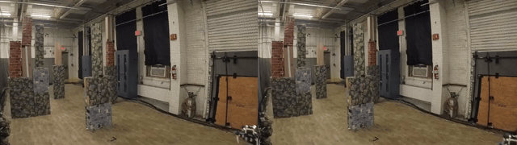
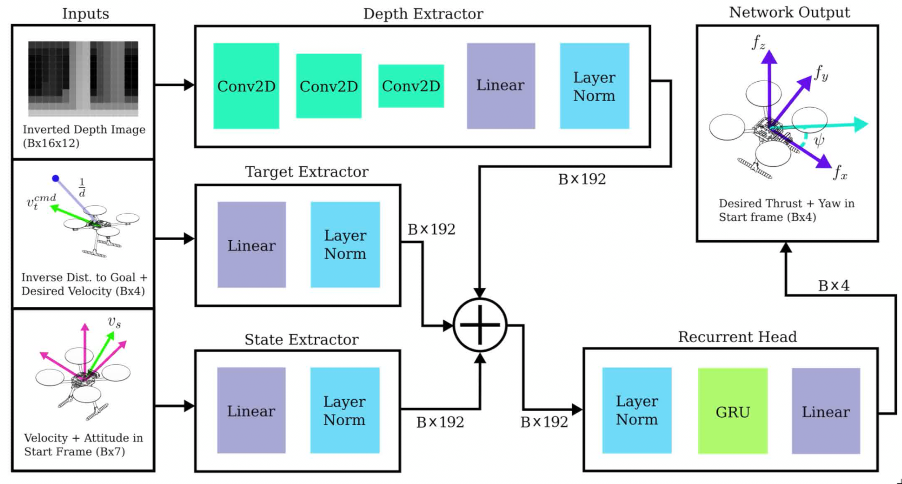

<div align="center">

# ClearNav: Perception-aligned quadrotor flight using differentiable physics

**Aditya Azad** \* · **Arthur Huang** \* · **Guanrui Li**

[Aerial-robot Control and Perception Lab (ACP Lab)](https://acp-lab.wpi.edu), Worcester Polytechnic Institute

\* Equal Contribution

[](https://arxiv.org/abs/2610.17419)
[](LICENSE)
[](https://github.com/acp-lab/clearnav)



</div>


## 📺 Video

[](https://www.youtube.com/watch?v=9hldGKQiQgc)

## 💡 Why ClearNav

Small drones that fly fast through clutter must stay safe when flying near obstacles. Policies trained in simulation and transferred to hardware fly brilliantly in open space, but as clearance shrinks, they collide.

We traced most of these collisions to a single mechanism: **the drone moves in directions its camera cannot see.**

ClearNav is a navigation policy that fixes this with three simple training objectives and each one only penalizes behaviour the drone can observe with its own camera at flight time.

**The result:** on 2,304 held-out test flights across 18 unseen scenarios, ClearNav flew **faster** than the state of the art (52% higher mean speed) while **cutting collisions by 65%**. Result transferred to a real quadrotor running entirely on onboard compute.

## ⚙️ How it works

ClearNav trains a ~2.2M-parameter recurrent policy entirely by **backpropagating through the physics simulator** (differentiable physics), instead of sampling thousands of RL rollouts. The policy sees only what a small drone has: a single forward depth camera and proprioception.

The baseline objective is augmented with three terms:

| Term | What it does | Why it's observable at inference |
|---|---|---|
| **Velocity-aware proximity** | Penalizes being *fast while close* to an obstacle, regardless of approach direction | Clearance and speed come from the depth image and proprioception |
| **Forward-looking heading** | Yaws the camera toward where the vehicle will be a moment from now, so the camera leads the path | Heading setpoint is commanded by the policy itself |
| **Lateral-velocity penalty** | Makes sideways (strafing) flight expensive, so the drone can't fly broadside past obstacles | Body-frame velocity is measured onboard |


<p align="center"></p>

Because every penalized behaviour is visible to the onboard sensors, the policy keeps the information it needs to act on its objective after deployment.

## 📊 Results

All evaluations use held-out scenes.

<div align="center">

| | Baseline (DepthNav) | **ClearNav (ours)** |
|---|---|---|
| Success rate (18 scenarios) | 90.3% | **97.1%** |
| Collision rate | 8.2% | **2.9%** (−65% relative) |
| Mean speed | 2.24 m/s | **3.39 m/s** (+52%) |

</div>

- **Faster *and* Safer**: About 1 m/s faster on average than baseline.
- **Consistent:** ClearNav wins 17 of 18 scenarios and ties the 18th. Gains are largest in dense clutter, clustered obstacles and tight arenas.
- **Moving obstacles:** Direction-consistent improvement, though not significant at the suite level.
- **Real world:** Flown on a physical quadrotor with the policy running onboard on a Jetson Orin NX.

## 🚀 Try it

### Setup

1. **Clone the repository:**

    ```bash
    git clone https://github.com/acp-lab/clearnav --recursive
    cd clearnav/
    ```

2. **Create a Python virtual environment:**

    ```bash
    python3.9 -m venv .venv # install python3.9 if you do not have it on the machine
    source .venv/bin/activate
    pip install --upgrade pip
    ```

3. **Install system-wide dependencies:**

    ```bash
    sudo apt-get update
    sudo apt-get install -y --no-install-recommends libjpeg-dev libglm-dev libgl1-mesa-glx libegl1-mesa-dev mesa-utils xorg-dev freeglut3-dev
    sudo apt-get install -y libcgal-dev
    ```

4. **Install Python dependencies:**

    ```bash
    pip install -r requirements.txt
    ```

5. **Verify PyTorch installation:**

    Ensure that PyTorch is installed with CUDA support.

    ```bash
    python -c "import torch; print(torch.__version__); print(torch.cuda.get_arch_list()); print(torch.randn(1).cuda())"
    ```

    You should see an output similar to:

    ```
    2.2.1+cu121
    ['sm_50', 'sm_60', 'sm_70', 'sm_75', 'sm_80', 'sm_86', 'sm_90']
    tensor([0.6627], device='cuda:0')
    ```

6. **Build and install `habitat-sim`:**

    ```bash
    cd habitat-sim
    python setup.py install --with-cuda --with-bullet --build-type Release --cmake-args="-DPYTHON_EXECUTABLE=$(which python) -DCMAKE_CXX_FLAGS_RELEASE='-O2 -march=x86-64-v2 -mno-avx -mno-avx2'"
    cd ..
    ```

7. **Install the `clearnav` module:**

    ```bash
    pip install -e .
    ```

8. **Download dataset:**

    ```bash
    cd datasets/
    ./get_dataset.sh
    ```

### Training

```bash
python examples/navigation/run_nav_level1.py
```

Follow the training progress with tensorboard:

```bash
source .venv/bin/activate
tensorboard --logdir examples/navigation/logs/
```

**Evaluate:**

```bash
python examples/navigation/eval_visual.py \
    --weight "examples/navigation/logs/level1/level1_1.pth" \
    --render \
    --num_envs 4 \
    --num_rollouts 10
```

## 📚 Cite

If you use this work in your research, kindly consider citing us:

```bibtex
@misc{azad2026clearnav,
  title         = {{ClearNav}: Perception-Aligned Quadrotor Flight Using Differential-Physics},
  author        = {Azad, Aditya and Huang, Arthur and Li, Guanrui},
  year          = {2026},
  eprint        = {2610.17419},
  archivePrefix = {arXiv},
  url           = {https://arxiv.org/abs/2610.17419}
}
```

## 📄 License & Acknowledgements

Released under the [MIT License](LICENSE).

- We also use [DiffAero](https://arxiv.org/abs/2509.10247) for our custom evaluation environments and policy comparison.
